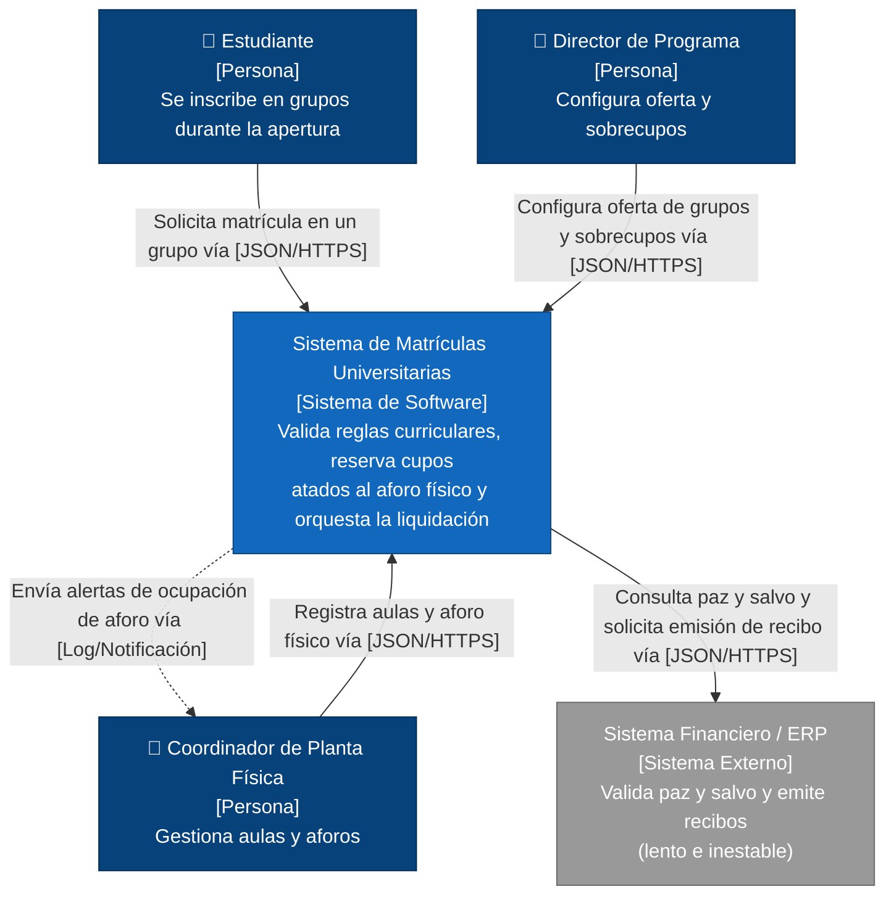
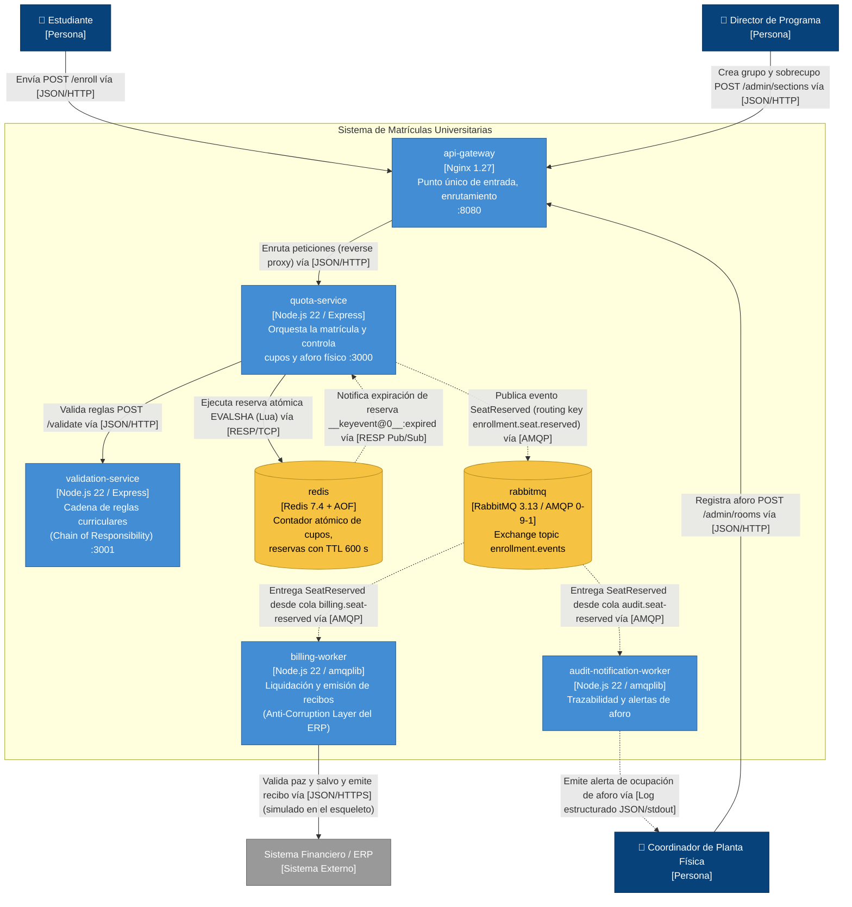

# Proyecto Integrador — Arquitectura de Software
## Entregable 1: Diseño Arquitectónico Documentado
### Motor de Matrículas Universitarias, Cruce de Horarios y Asignación de Aulas

| Campo | Valor |
|---|---|
| Versión del documento | 1.0 |
| Fecha | 2026-11-11 |
| Entregable asociado | Entregable 2 — Walking Skeleton (`docker compose up --build`) |
| Regla de coherencia | Cada caja del C4 Nivel 2 = un servicio del `docker-compose.yml`; cada flecha = un protocolo real en el código (ver §6.3) |

---

## 0. Resumen del problema

El sistema recibe la **estampida de apertura de matrícula**: ~2.000 estudiantes concurrentes a las 08:00 compitiendo por cupos limitados por el **aforo físico** del aula o laboratorio. Cada inscripción debe pasar una **validación curricular en cadena** (prerrequisitos, correquisitos, tope de créditos según promedio, choque de horario), luego **reservar atómicamente** un asiento con **TTL de 10 minutos**, y finalmente generar la **orden financiera** en un **ERP externo lento e inestable** (paz y salvo + recibo).

Las tres fuerzas que dominan el diseño son, por tanto:

1. **Concurrencia extrema sobre un recurso escaso** (el último asiento de un aula).
2. **Una dependencia externa que no controlamos** y que es más lenta que nuestra tasa de llegada.
3. **Reglas académicas que cambian cada semestre**, a un ritmo distinto al del resto del sistema.

### Actores

| Actor | Rol | Perfil de interacción |
|---|---|---|
| Estudiante | Se inscribe en grupos | Ráfagas masivas, sensibles a latencia |
| Director de Programa | Configura la oferta de grupos y autoriza sobrecupos | Baja frecuencia, antes de la apertura |
| Coordinador de Planta Física | Registra aulas/laboratorios y su aforo legal | Baja frecuencia; recibe alertas de ocupación |
| Tesorería / ERP Financiero (externo) | Valida paz y salvo, emite recibos | Sistema externo, latencia 2–8 s, caídas frecuentes |

---

## 1. Drivers priorizados — Árbol de Utilidad

### 1.1 Restricciones (no negociables)

| ID | Restricción | Origen | Impacto en el diseño |
|---|---|---|---|
| C-1 | El ERP financiero es externo, no modificable, de latencia 2–8 s y con ventanas de indisponibilidad | Contrato con proveedor / Tesorería | Prohíbe ponerlo en la ruta síncrona de la reserva |
| C-2 | El número de inscritos de un grupo **nunca** puede superar el aforo físico del aula asignada | Normativa de seguridad y planta física | Invariante dura: exige control atómico del contador |
| C-3 | La reserva de cupo expira a los 10 minutos si no se genera la orden financiera | Reglamento de matrícula | Exige TTL nativo por reserva |
| C-4 | El sistema completo debe arrancar con un solo comando (`docker compose up`) | Rúbrica del curso | Toda la infraestructura debe ser contenerizable |
| C-5 | Equipo pequeño, un semestre de desarrollo | Contexto académico | Favorece tecnologías conocidas (Node.js, Redis, RabbitMQ) |

### 1.2 Árbol de Utilidad

Escala: **Importancia para el negocio** / **Dificultad técnica** → Alta (H), Media (M), Baja (L).

| Atributo de calidad | Refinamiento | ID | Hoja (escenario resumido) | (I, D) |
|---|---|---|---|---|
| **Integridad / Consistencia** | Invariante de aforo | **U-1** | 100 solicitudes simultáneas por el último asiento de un aula producen exactamente 1 reserva y 99 rechazos; 0 sobreventas | **(H, H)** |
| **Rendimiento / Concurrencia** | Latencia bajo estampida | **U-2** | 2.000 estudiantes concurrentes a las 08:00 obtienen respuesta (aceptada o rechazada) con p95 < 800 ms | **(H, H)** |
| **Disponibilidad / Resiliencia** | Aislamiento de fallos externos | **U-3** | Con el ERP caído 2 h, la reserva de cupos sigue operando con 0 % de errores atribuibles al ERP y los recibos se emiten al recuperarse | **(H, H)** |
| **Modificabilidad** | Reglas curriculares | U-4 | Agregar una regla nueva (p. ej. "máx. 2 laboratorios por semestre") cuesta < 1 día-persona y no toca `quota-service` | (H, M) |
| **Disponibilidad / Resiliencia** | Liberación de reservas | U-5 | Una reserva no confirmada libera su asiento en ≤ TTL + 30 s | (H, M) |
| **Escalabilidad** | Crecimiento de demanda | U-6 | Pasar a 20.000 concurrentes sin rediseñar la frontera de los contextos | (M, H) |
| **Modificabilidad** | Sustitución de proveedor | U-7 | Cambiar de ERP solo afecta a `billing-worker` (adaptador) | (M, M) |
| **Observabilidad** | Trazabilidad distribuida | U-8 | Una matrícula se rastrea entre los 4 procesos con un único `correlationId` | (M, L) |

**Discriminación explícita:** solo U-1, U-2 y U-3 son `(H, H)` y son los **drivers arquitectónicos** que determinan el estilo y las tácticas. U-4 y U-5 son importantes pero de dificultad media (se resuelven con patrones conocidos). U-6 se prioriza como `M` porque la demanda actual es 2.000 y el crecimiento 10× es especulativo, aunque difícil. U-8 es barato de lograr pero no crítico para el negocio.

---

## 2. Escenarios de Atributos de Calidad (formato de 6 partes de Bass)

### ESC-1 — Integridad del aforo ante concurrencia (driver U-1)

| Parte | Descripción |
|---|---|
| **Fuente** | 100 estudiantes elegibles (validación curricular aprobada) |
| **Estímulo** | Envían simultáneamente (ventana < 50 ms) `POST /enroll` al mismo grupo, al que le queda **1** asiento |
| **Artefacto** | `quota-service` + Redis (contador `section:{id}:seats`) |
| **Entorno** | Operación pico (apertura del turno 08:00), carga nominal de 2.000 usuarios concurrentes |
| **Respuesta** | Exactamente una solicitud obtiene `201 Created` con su reserva; las otras 99 reciben `409 Conflict` (`SEAT_LIMIT_REACHED`). Se publica exactamente **un** evento `SeatReserved` |
| **Medida de respuesta** | **0** sobreventas en 1.000 ejecuciones repetidas del experimento; contador final = 0 (nunca negativo); 1 evento publicado por ejecución; latencia de rechazo p99 < 50 ms |

### ESC-2 — Rendimiento bajo estampida (driver U-2)

| Parte | Descripción |
|---|---|
| **Fuente** | 2.000 estudiantes (clientes web) |
| **Estímulo** | Rampa de 0 a 2.000 usuarios concurrentes en 60 s, cada uno emitiendo 1–3 `POST /enroll` |
| **Artefacto** | Ruta síncrona: `api-gateway` → `quota-service` → `validation-service` → Redis → RabbitMQ (publish) |
| **Entorno** | Pico de apertura, ERP externo en estado normal (2–8 s de latencia) |
| **Respuesta** | El sistema responde a cada solicitud con aceptación o rechazo **sin esperar al ERP** |
| **Medida de respuesta** | p95 < 800 ms, p99 < 1.500 ms, throughput sostenido ≥ 500 req/s, tasa de error 5xx < 0,1 % |

### ESC-3 — Resiliencia ante caída del ERP externo (driver U-3)

| Parte | Descripción |
|---|---|
| **Fuente** | Sistema Financiero / ERP externo |
| **Estímulo** | Deja de responder (timeouts / HTTP 503) durante **2 horas** en pleno periodo de matrícula |
| **Artefacto** | `billing-worker`, cola `billing.seat-reserved` en RabbitMQ |
| **Entorno** | Operación pico, ~4.000 reservas generadas durante la caída |
| **Respuesta** | `quota-service` sigue reservando y publicando; los eventos se acumulan de forma durable; `billing-worker` reintenta con backoff y al recuperarse el ERP drena la cola |
| **Medida de respuesta** | 0 % de solicitudes `/enroll` fallidas por causa del ERP; 0 mensajes perdidos (persistentes + ack manual); cola drenada en ≤ 30 min tras la recuperación a 5 msg/s; 0 recibos duplicados (idempotencia por `eventId`) |

### ESC-4 — Modificabilidad de reglas curriculares (driver U-4)

| Parte | Descripción |
|---|---|
| **Fuente** | Director de Programa / equipo de desarrollo |
| **Estímulo** | Solicitud de nueva regla: "un estudiante en prueba académica (promedio < 3,0) no puede inscribir más de 12 créditos" |
| **Artefacto** | `validation-service` (cadena de reglas) |
| **Entorno** | Tiempo de desarrollo, entre semestres |
| **Respuesta** | Se agrega una clase `Rule` nueva y se registra en la cadena; ningún otro servicio se modifica ni se redespliega |
| **Medida de respuesta** | ≤ 1 día-persona (≤ 8 h) incluyendo pruebas; 0 líneas cambiadas en `quota-service`, `billing-worker` y `audit-notification-worker`; 1 solo contenedor redesplegado |

---

## 3. Estilo Arquitectónico Elegido

**Microservicios con comunicación híbrida:**
- **Síncrona (REST/JSON sobre HTTP)** en la ruta crítica que el estudiante espera: validación curricular y reserva atómica.
- **Asíncrona basada en eventos (AMQP 0-9-1 sobre RabbitMQ)** para todo lo que depende del ERP externo o no necesita respuesta inmediata (liquidación, auditoría, alertas de aforo).

### 3.1 Matriz Decisión → Driver → Trade-off

| Decisión estructural | Driver que la motiva | Atributo que empeora | Por qué es aceptable en este dominio |
|---|---|---|---|
| Separar `validation-service`, `quota-service` y `billing-worker` en procesos independientes | U-3, U-4, U-6 | **Operabilidad / complejidad operacional**: más contenedores, despliegue distribuido, logs dispersos | El costo se paga una vez (Docker Compose / orquestador) y se mitiga con `correlationId` (U-8). A cambio, una caída del ERP o un cambio de reglas no afecta la reserva |
| Llamada síncrona HTTP `quota-service` → `validation-service` | U-1 (no reservar asientos a no elegibles), U-2 | **Latencia**: añade un salto de red interno (~2–10 ms) y acoplamiento temporal | El estudiante necesita saber **en el acto** si es elegible; la validación es de solo lectura y cálculo en memoria, su costo es despreciable frente al presupuesto de 800 ms |
| Contador de cupos en Redis con script Lua atómico | U-1, U-2 | **Simplicidad de infraestructura** y **durabilidad** (memoria + AOF en vez de BD transaccional) | El contador es un dato derivado y reconstruible desde el registro de matrículas; la ventana de pérdida con AOF `everysec` es ≤ 1 s (ver Riesgo R-1) |
| Publicar `SeatReserved` en RabbitMQ en lugar de llamar al ERP | U-3, U-2 | **Inmediatez / consistencia**: el recibo se emite con consistencia eventual (segundos a horas) | El reglamento ya concede 10 min de reserva (C-3); el recibo nunca fue instantáneo con este ERP. Aislar la caída del ERP vale más que la inmediatez |
| Exchange `topic` con una cola por consumidor (`billing`, `audit`) | U-7, U-8 | **Consumo de recursos del broker** (mensajes duplicados por cola) | Permite agregar consumidores (notificaciones, analítica) sin tocar el productor |
| `api-gateway` (Nginx) como punto único de entrada | U-2, U-6 | Un salto adicional y un punto único de fallo lógico | Centraliza el enrutamiento y es el lugar natural para admission control / rate limiting en el crecimiento 10× |

### 3.2 Alternativas de estilo consideradas

| Estilo | Por qué no |
|---|---|
| Monolito modular | Un solo proceso: la saturación del pool de hilos por llamadas lentas al ERP degrada también la reserva; no se puede escalar la reserva independientemente de la validación |
| Microservicios 100 % síncronos | Acopla temporalmente la respuesta del estudiante a la latencia (2–8 s) y disponibilidad del ERP; viola ESC-2 y ESC-3 |
| 100 % asíncrono (CQRS/event sourcing completo) | El estudiante quedaría esperando "su matrícula está en proceso" sin saber si obtuvo el cupo; complejidad desproporcionada para el equipo (C-5) |

---

## 4. Contextos Delimitados (Bounded Contexts)

### 4.1 Mapa de contextos

```
┌──────────────────────────┐   Customer/Supplier (síncrono)   ┌───────────────────────────┐
│ 1. Validación Curricular │ <─────────────────────────────── │ 2. Control de Cupos y     │
│   (validation-service)   │   "¿es elegible este estudiante  │    Aforo Físico           │
│   UPSTREAM (Supplier)    │    para este grupo?"             │   (quota-service) D/S     │
└──────────────────────────┘                                  └─────────────┬─────────────┘
                                                                            │ Published Language
                                                                            │ evento SeatReserved (AMQP)
                                              ┌─────────────────────────────┴───────────────┐
                                              ▼                                             ▼
                               ┌──────────────────────────────┐          ┌──────────────────────────────┐
                               │ 3. Integración Financiera y  │          │ (soporte) Auditoría y        │
                               │    Liquidación               │          │  Alertas de Aforo            │
                               │   (billing-worker)           │          │ (audit-notification-worker)  │
                               │   Anti-Corruption Layer ──────────► ERP externo (Conformist evitado)
                               └──────────────────────────────┘          └──────────────────────────────┘
```

### 4.2 Detalle por contexto

| | **C1 · Validación Curricular** | **C2 · Control de Cupos y Aforo Físico** | **C3 · Integración Financiera y Liquidación** |
|---|---|---|---|
| **Servicio** | `validation-service` | `quota-service` | `billing-worker` |
| **Responsabilidad** | Decidir si un estudiante *puede* inscribir un grupo según el plan de estudios | Decidir si *hay asiento físico* y reservarlo de forma atómica con TTL | Traducir una reserva en una orden de pago del ERP y emitir el recibo |
| **Lenguaje ubicuo** | *Plan de estudios, prerrequisito, correquisito, crédito, tope de créditos, promedio acumulado, prueba académica, franja horaria, choque de horario, regla curricular* | *Grupo (sección), aula, laboratorio, aforo, cupo ofertado, cupo disponible, sobrecupo autorizado, reserva, expiración (TTL), liberación* | *Liquidación, orden de pago, paz y salvo, recibo, referencia de pago, reintento, idempotencia* |
| **Entidades / Agregados** | `Student` (historial aprobado, promedio, horario inscrito), `CourseSection` (curricular: créditos, prerrequisitos, horario), `Rule` | `Room` (aforo), `Section` (oferta, aula asignada) — **agregado** con invariante `disponibles ≥ 0 ∧ inscritos ≤ aforo`, `Reservation` (TTL) | `BillingOrder`, `Receipt`, `ClearanceStatus` |
| **Perfil de carga** | Solo lectura + cálculo puro en memoria; idempotente; cacheable | Escritura concurrente intensa sobre pocas claves calientes | Baja tasa, alta latencia, I/O externo |
| **Señal heurística que justifica la frontera** | **Tasa de cambio distinta**: las reglas cambian cada semestre por decisión académica, mientras el control de cupos es estable. **Perfil de carga** de solo lectura (escala horizontal trivial) | **Invariante de consistencia fuerte**: la regla "inscritos ≤ aforo" debe protegerse dentro de una sola frontera transaccional; partirla implicaría transacciones distribuidas | **Aislamiento de fallos externos**: acopla con un ERP lento/inestable; su modelo (recibos, referencias) no debe contaminar el dominio académico (Anti-Corruption Layer) |

El contenedor `audit-notification-worker` **no** es un contexto de negocio adicional: es un **subdominio de soporte** que consume el lenguaje publicado (`SeatReserved`) para trazabilidad y alertas al Coordinador de Planta Física. Existe en el esqueleto para demostrar la **independencia de consumidores** (fan-out) del estilo basado en eventos.

### 4.3 Lenguaje publicado — Evento `SeatReserved` (contrato v1)

```json
{
  "eventType": "SeatReserved",
  "eventVersion": 1,
  "eventId": "uuid",
  "correlationId": "uuid",
  "occurredAt": "2026-11-11T08:00:00.123Z",
  "data": {
    "reservationId": "uuid",
    "studentId": "est-001",
    "sectionId": "ARQSW-01",
    "roomId": "AULA-301",
    "roomCapacity": 2,
    "remainingSeats": 1,
    "credits": 3,
    "expiresAt": "2026-11-11T08:10:00.123Z"
  }
}
```

---

## 5. Tácticas Arquitectónicas Aplicadas

| Táctica | Dónde | Escenario al que responde | Mecanismo concreto | Atributo que degrada |
|---|---|---|---|---|
| **T-1 · Control de concurrencia por operación atómica (Atomic check-and-decrement en Redis, script Lua)** | `quota-service` + Redis | **ESC-1** (0 sobreventas) y **ESC-2** (p95 < 800 ms) | Un único script Lua ejecuta, sin interleaving posible (Redis es single-thread por comando): verificar que el grupo existe → verificar que el estudiante no tenga ya reserva → verificar `seats > 0` → `DECR` → `SET hold:{sección}:{estudiante} EX 600`. La liberación por TTL usa notificaciones de expiración (`notify-keyspace-events Ex`) que reincrementan el contador | **Simplicidad de infraestructura** (un componente más que operar) y **durabilidad** (estado en memoria, mitigado con AOF) |
| **T-2 · Nivelación de carga basada en colas (Queue-Based Load Leveling)** | Entre `quota-service` y `billing-worker` vía RabbitMQ | **ESC-3** (ERP caído 2 h) y **ESC-2** (no esperar al ERP) | Exchange `enrollment.events` (topic, durable) → cola `billing.seat-reserved` (durable, mensajes persistentes). `billing-worker` usa `prefetch` limitado (ritmo que el ERP tolera), `ack` manual, reintentos con backoff y cola de mensajes muertos (`billing.dlq`) | **Inmediatez del recibo**: pasa de síncrono a consistencia eventual; se requiere idempotencia en el consumidor |
| **T-3 · Externalización de reglas (Chain of Responsibility + Strategy)** | `validation-service` | **ESC-4** (nueva regla en < 1 día sin tocar la reserva) | Cada regla implementa la interfaz `Rule { name, evaluate(ctx) }` y se encadena: `PrerequisiteRule → CorequisiteRule → CreditLimitRule → ScheduleConflictRule`. La cadena se corta en la primera violación y devuelve el código de la regla. Agregar una regla = una clase + una línea de registro | Ligero **overhead de procesamiento** (recorrido de la cadena en memoria, < 1 ms) y **mayor número de abstracciones** |

Tácticas de apoyo (menores): **Idempotencia** en `billing-worker` (deduplicación por `eventId`), **Correlation ID** propagado por cabecera HTTP `x-correlation-id` y en el payload del evento (U-8), **Health checks** en Docker Compose para arranque ordenado.

---

## 6. Diagramas C4

**Leyenda (aplica a ambos niveles)**

| Notación | Significado |
|---|---|
| Caja azul oscuro (persona) | Actor humano |
| Caja azul | Sistema / contenedor propio, con `[Tecnología]` |
| Caja gris | Sistema externo fuera de nuestro control |
| Cilindro / caja amarilla | Almacén de datos o infraestructura de mensajería |
| Flecha continua `-->` | Comunicación **síncrona** (petición/respuesta) |
| Flecha punteada `-.->` | Comunicación **asíncrona** (eventos / notificaciones) |
| Texto de la flecha | `Acción vía [Protocolo]` |

### 6.1 Nivel 1 — Diagrama de Contexto



### 6.2 Nivel 2 — Diagrama de Contenedores



### 6.3 Matriz de coherencia C4 Nivel 2 ↔ código (Entregable 2)

| Caja C4 N2 | Servicio en `docker-compose.yml` | Carpeta de código | Puerto |
|---|---|---|---|
| api-gateway [Nginx] | `api-gateway` | `gateway/` | 8080 |
| quota-service [Node.js/Express] | `quota-service` | `services/quota-service/` | 3000 |
| validation-service [Node.js/Express] | `validation-service` | `services/validation-service/` | 3001 |
| redis [Redis 7.4] | `redis` | (imagen oficial, AOF habilitado) | 6379 |
| rabbitmq [RabbitMQ 3.13] | `rabbitmq` | (imagen oficial + management) | 5672 / 15672 |
| billing-worker [Node.js/amqplib] | `billing-worker` | `workers/billing-worker/` | — |
| audit-notification-worker [Node.js/amqplib] | `audit-notification-worker` | `workers/audit-notification-worker/` | — |
| ERP [Sistema Externo] | **No es contenedor** (es externo, Nivel 1). En el esqueleto se simula dentro del adaptador `erpClient` de `billing-worker` | `workers/billing-worker/src/erpClient.js` | — |

| Flecha C4 N2 | Implementación en código |
|---|---|
| `quota-service → validation-service` [JSON/HTTP] | `fetch('http://validation-service:3001/validate')` en `quota-service/src/validationClient.js` |
| `quota-service → redis` [RESP] | `redis.evalsha(...)` del script `reserve_seat.lua` (ioredis) |
| `redis -.-> quota-service` [RESP Pub/Sub] | `subscriber.subscribe('__keyevent@0__:expired')` en `quota-service/src/expiryListener.js` |
| `quota-service -.-> rabbitmq` [AMQP] | `channel.publish('enrollment.events', 'enrollment.seat.reserved', ...)` |
| `rabbitmq -.-> billing-worker` / `audit-notification-worker` [AMQP] | `channel.consume('billing.seat-reserved')` / `channel.consume('audit.seat-reserved')` |

---

## 7. Architecture Decision Records

### ADR-001 — Microservicios con comunicación híbrida (REST + eventos AMQP)

**1. Título y Estado**
ADR-001: Adoptar microservicios con comunicación híbrida (REST síncrono para validación/reserva, eventos AMQP para liquidación). **Estado: Aceptado** (2026-11-11).

**2. Contexto y Driver que lo motiva**
Drivers U-2 (p95 < 800 ms con 2.000 concurrentes), U-3 (operar con el ERP caído 2 h) y U-4 (reglas curriculares con tasa de cambio semestral). Restricción C-1 (ERP lento e inestable). El estudiante necesita una respuesta inmediata y definitiva sobre su cupo, pero la parte financiera depende de un tercero cuya latencia (2–8 s) supera por sí sola el presupuesto de respuesta. Los tres contextos delimitados tienen perfiles de carga y tasas de cambio distintos (§4).

**3. Decisión**
Desplegar `validation-service`, `quota-service` y `billing-worker` (más `audit-notification-worker` como soporte) como procesos independientes. La ruta que el estudiante espera (`gateway → quota → validation → redis`) es **síncrona REST/JSON**. Toda interacción con el ERP y toda reacción secundaria se dispara por el evento **`SeatReserved` publicado en RabbitMQ** (exchange `topic` durable, una cola por consumidor).

**4. Alternativas descartadas**
- **Monolito modular:** compartiría proceso, memoria y pool de conexiones/hilos. Bajo estampida, las llamadas bloqueadas al ERP (2–8 s cada una) ocuparían workers del mismo runtime que atiende `/enroll`, degradando la reserva (viola ESC-2/ESC-3). Además, cambiar una regla curricular obligaría a redesplegar el componente que custodia el contador de cupos en plena temporada (viola ESC-4). No permite escalar la reserva sin escalar todo.
- **Microservicios 100 % síncronos (REST encadenado hasta el ERP):** la latencia de la respuesta sería `latencia(ERP) + resto` ≥ 2 s, y su disponibilidad sería el producto de las disponibilidades de la cadena (si el ERP está al 95 %, el sistema nunca supera el 95 %). Un ERP caído provoca reintentos del cliente y amplificación de carga (retry storm). Solo un circuit breaker no basta: con el circuito abierto la matrícula fallaría igual.
- **Coreografía 100 % asíncrona (incluida la reserva):** el estudiante recibiría "solicitud en proceso" y tendría que hacer *polling*; se pierde la confirmación inmediata del cupo, que es el núcleo de la experiencia de usuario, y aumenta la complejidad (sagas completas) más allá de la capacidad del equipo (C-5).

**5. Consecuencias**
- *Positivas:* la caída del ERP no afecta `/enroll`; cada contexto escala y se despliega por separado; nuevos consumidores del evento se agregan sin tocar al productor; la frontera de despliegue coincide con la frontera de los contextos.
- *Negativas:* mayor complejidad operacional (7 contenedores, health checks, orden de arranque); latencia de red interna adicional (~2–10 ms por salto); consistencia eventual entre "cupo reservado" y "recibo emitido"; depuración distribuida (mitigada con `correlationId`); el estado "reservado pero sin recibo" debe gestionarse explícitamente (TTL, ADR-002).

---

### ADR-002 — Control de cupos con operaciones atómicas en Redis (Lua/DECR) con TTL

**1. Título y Estado**
ADR-002: Usar un script Lua atómico en Redis (check-and-decrement + reserva con `EX 600`) para el control de cupos y aforos, en lugar de bloqueos pesimistas en base de datos relacional. **Estado: Aceptado** (2026-11-11).

**2. Contexto y Driver que lo motiva**
Driver U-1 / ESC-1 (0 sobreventas con 100 peticiones simultáneas por el último asiento) y U-2 / ESC-2 (p95 < 800 ms). Restricciones C-2 (inscritos ≤ aforo físico) y C-3 (reserva temporal de 10 min). En la apertura, cientos de solicitudes compiten por **la misma fila** (el grupo popular): es un patrón de *hot key* con contención extrema.

**3. Decisión**
El contador `section:{id}:seats` se inicializa con `min(cupo ofertado + sobrecupo autorizado, aforo del aula)`. La reserva se ejecuta con un único script Lua (`reserve_seat.lua`) que, de forma indivisible: (a) verifica que el grupo existe, (b) rechaza si el estudiante ya tiene reserva, (c) rechaza si `seats ≤ 0`, (d) decrementa, (e) crea `hold:{sección}:{estudiante}` con TTL de 600 s. La expiración del `hold` dispara (vía `notify-keyspace-events Ex`) la reposición del asiento. Redis corre con AOF `appendfsync everysec`.

**4. Alternativas descartadas**
- **Bloqueo pesimista `SELECT ... FOR UPDATE` en PostgreSQL:** serializa todas las transacciones del grupo caliente sobre un *row lock*; cada transacción retiene el bloqueo durante un viaje de red + commit con `fsync` (~5–20 ms), lo que limita el grupo a ~50–200 reservas/s y genera colas de espera de conexiones; con 2.000 concurrentes se agota el pool de conexiones y aparecen timeouts y *deadlocks* (viola ESC-2). Además el TTL de 10 min requeriría un *job* programado que barra reservas vencidas.
- **Bloqueo optimista (columna `version` + reintento):** correcto en baja contención, pero con 100 competidores por el mismo registro casi todas las transacciones fallan y reintentan, multiplicando la carga (*livelock*) justo en el pico.
- **Lock distribuido Redlock + escritura en BD:** dos sistemas que coordinar, el lock tiene su propio TTL y riesgo de expirar con la operación a medio camino (pausas de GC); más lento y más complejo que una operación atómica que *ya es* el lock.
- **`DECR` simple sin script:** dos comandos separados (`GET` + `DECR` o `DECR` + `INCR` compensatorio) dejan ventanas donde el contador queda negativo transitoriamente y no permiten crear el `hold` en la misma operación.

**5. Consecuencias**
- *Positivas:* atomicidad garantizada por el modelo single-thread de Redis (no hay interleaving dentro del script); latencia sub-milisegundo; el TTL es nativo (no hay *job* de barrido); el rechazo por falta de cupo es inmediato y no consume conexiones de BD.
- *Negativas:* nuevo componente de infraestructura a operar; el estado vive en memoria con ventana de pérdida ≤ 1 s (AOF everysec) ante caída abrupta (Riesgo R-1); las notificaciones de expiración son *fire-and-forget*: si `quota-service` está caído cuando expira un `hold`, el asiento no se repone automáticamente (Riesgo R-3); un nodo Redis único es un punto único de fallo y de escala (mitigación: Sentinel/Cluster con *hash tags* `{sectionId}`).

---

### ADR-003 — Liquidación financiera desacoplada mediante cola (Queue-Based Load Leveling)

**1. Título y Estado**
ADR-003: Desacoplar la liquidación hacia el ERP externo mediante RabbitMQ (cola durable + consumidor con ritmo controlado), en lugar de una llamada HTTP síncrona directa. **Estado: Aceptado** (2026-11-11).

**2. Contexto y Driver que lo motiva**
Driver U-3 / ESC-3 (ERP caído 2 h sin afectar la matrícula) y U-2 / ESC-2. Restricción C-1: el ERP tiene latencia de 2–8 s, capacidad estimada de ~5 solicitudes/s y caídas frecuentes. La tasa de llegada en la apertura (cientos de reservas por segundo) excede en dos órdenes de magnitud la capacidad del ERP.

**3. Decisión**
`quota-service` publica `SeatReserved` (persistente, `deliveryMode: 2`) en el exchange `enrollment.events`. `billing-worker` consume de `billing.seat-reserved` con `prefetch` limitado (ritmo tolerable por el ERP), `ack` manual tras éxito, reintento con backoff exponencial (máx. 5) y envío a `billing.dlq` al agotarlos. El consumidor es **idempotente** por `eventId`. El adaptador `erpClient` actúa como Anti-Corruption Layer.

**4. Alternativas descartadas**
- **Llamada HTTP síncrona directa al ERP desde `quota-service`:** la respuesta al estudiante heredaría la latencia de 2–8 s (viola p95 < 800 ms) y su disponibilidad; con el ERP caído, el 100 % de las matrículas fallaría. Los hilos/sockets bloqueados esperando al ERP agotarían los recursos del servicio que protege el invariante de aforo.
- **HTTP síncrono con Circuit Breaker + Retry:** protege los recursos del llamador, pero con el circuito abierto la operación **igual falla** o queda sin recibo y sin registro durable para reintentar; habría que inventar una tabla de pendientes (*outbox* manual) que reimplementa una cola peor.
- **Tabla de pendientes en BD + *polling* con cron:** introduce latencia fija del intervalo de polling, contención sobre la tabla y lógica de bloqueo para evitar que dos workers tomen la misma fila; RabbitMQ ya resuelve entrega, ack, reintentos y DLQ.
- **Apache Kafka:** apto para alto volumen y *replay*, pero su operación (particiones, offsets, KRaft) es desproporcionada para ~2.000 eventos por pico; RabbitMQ ofrece ruteo por cola, ack por mensaje y DLQ nativos, más adecuados a un *work queue*.

**5. Consecuencias**
- *Positivas:* la matrícula es inmune a la latencia y caídas del ERP; la cola absorbe el pico y el ERP recibe un flujo constante; los mensajes sobreviven reinicios (durables + persistentes); permite fan-out a nuevos consumidores (auditoría).
- *Negativas:* consistencia eventual — el recibo puede tardar minutos u horas; **riesgo de expiración del TTL** (10 min) antes de que el recibo se emita si el ERP está caído (requiere política de negocio: extender el `hold` mientras el evento esté en cola, ver R-2); semántica *at-least-once* obliga a idempotencia; la cola puede crecer sin límite si el ERP no se recupera (R-2); necesidad de monitorear la profundidad de la cola y la DLQ.

---

## 8. Riesgos Arquitectónicos Identificados

| ID | Riesgo | Causa | Impacto | Probabilidad |
|---|---|---|---|---|
| **R-1** | **Desincronización del contador de Redis** tras caída abrupta del nodo | AOF `everysec` puede perder hasta ~1 s de escrituras; al reiniciar, el contador "devuelve" asientos ya reservados | Sobreventa (violación de C-2) | Media |
| **R-2** | **Saturación de RabbitMQ / vencimiento masivo de reservas** si el ERP cae > 2 h | La cola crece (memoria/disco del broker) y las reservas expiran (TTL 10 min) antes de emitir el recibo | Broker en *flow control* bloquea publicaciones → `/enroll` falla; estudiantes pierden cupos ya obtenidos | Media |
| **R-3** | **Fuga de asientos** por notificaciones de expiración perdidas | `notify-keyspace-events` es Pub/Sub sin persistencia: si `quota-service` está caído cuando expira un `hold`, nadie repone el asiento | Cupos "fantasma" que nadie puede tomar | Baja-Media |
| R-4 | Cuello de botella síncrono en `validation-service` ante crecimiento 10× | Un salto HTTP obligatorio por cada intento | Aumento de p95, efecto cascada | Media (a 10×) |

### 8.1 Protocolos de verificación / experimentos

**Experimento E-1 (descarta R-1) — Prueba de caos sobre Redis**
1. Inicializar un grupo con 500 cupos. 2. Lanzar con `k6`/`autocannon` 2.000 `POST /enroll` con estudiantes distintos a 500 req/s. 3. A los 2 s ejecutar `docker kill -s SIGKILL redis` y `docker compose start redis`. 4. Comparar: `500 − valor(section:{id}:seats)` vs. número de `hold:*` vivos + eventos `SeatReserved` registrados por `audit-notification-worker`.
**Criterio de aceptación:** discrepancia = 0. **Si falla:** activar `appendfsync always` para las claves de cupos (costo medido de latencia) o implementar un *reconciliador* al arranque que recalcule `seats = capacidad − |holds| − |confirmados|` desde la fuente durable antes de aceptar tráfico.

**Experimento E-2 (descarta R-2) — Caída prolongada del ERP**
1. Configurar `ERP_FAILURE_RATE=1.0` en `billing-worker` (ERP siempre falla). 2. Generar 4.000 reservas en 30 min. 3. Medir cada minuto con `rabbitmqctl list_queues name messages` y la API de management: profundidad, memoria del broker, alarmas (`mem_alarm`, `disk_alarm`). 4. Restaurar `ERP_FAILURE_RATE=0` y medir el tiempo de drenaje.
**Criterio de aceptación:** ninguna alarma de memoria/disco, 0 publicaciones bloqueadas, 0 mensajes perdidos, drenaje ≤ 30 min, 0 recibos duplicados. **Mitigaciones preparadas:** colas *lazy*/quorum (mensajes en disco), `x-max-length` con *overflow* `reject-publish` para fallar rápido, y política de negocio de **extensión del TTL** del `hold` mientras exista un evento pendiente de liquidar.

**Experimento E-3 (descarta R-3) — Expiración con consumidor caído**
1. Configurar `RESERVATION_TTL_SECONDS=20`. 2. Reservar 2 cupos. 3. `docker compose stop quota-service` durante 30 s. 4. `docker compose start quota-service`. 5. Verificar `GET /sections/{id}`.
**Criterio de aceptación:** los 2 cupos repuestos. **Resultado esperado con el diseño actual: falla** (riesgo confirmado). **Mitigación:** barrido de reconciliación al arranque y periódico (cada 60 s) que compara un `SET` de reservas activas `section:{id}:holds` con las claves `hold:*` existentes y repone las faltantes.

**Experimento E-4 (descarta R-4) — Prueba de carga escalonada**
Rampa 2k → 5k → 10k → 20k usuarios virtuales; registrar p95 de `/validate` y de `/enroll`, uso de CPU por contenedor. El primer componente cuya CPU supere el 80 % o cuyo p95 rompa el presupuesto identifica el cuello de botella (ver pregunta 4).

---

## 9. Preguntas de sustentación del jurado

### 1. ¿Qué driver justifica cada decisión y de dónde salió?

| Decisión | Driver | Origen del driver |
|---|---|---|
| Microservicios híbridos (ADR-001) | U-2, U-3, U-4 | Restricción del enunciado: estampida de 2.000 concurrentes a las 08:00 + ERP externo lento/inestable + reglas que cambian por semestre (taller de árbol de utilidad con los stakeholders: Estudiantes, Director, Tesorería) |
| Redis Lua atómico + TTL (ADR-002) | U-1 (H,H), U-2 | Normativa de aforo físico (C-2), reglamento de reserva de 10 min (C-3); el Coordinador de Planta Física es el stakeholder que exige "nunca más inscritos que sillas" |
| Cola RabbitMQ hacia el ERP (ADR-003) | U-3 (H,H) | Restricción C-1: contrato con el proveedor del ERP (latencia 2–8 s, caídas); Tesorería exige que no se pierda ningún recibo |
| Chain of Responsibility en validación | U-4 (H,M) | Director de Programa: el plan de estudios y las reglas cambian cada semestre |
| `api-gateway` | U-2, U-6 | Necesidad de un punto de control para admission control/rate limiting ante el crecimiento |

### 2. ¿Qué alternativa descartaron y por qué?

- **Monolito modular** → el ERP lento compartiría recursos con la reserva y cada cambio de reglas obligaría a redesplegar el componente que custodia el aforo.
- **Microservicios 100 % síncronos** → la latencia y la disponibilidad de la matrícula quedarían acotadas por las del ERP (≥ 2 s; ≤ disponibilidad del ERP).
- **`SELECT FOR UPDATE` en PostgreSQL** → serializa sobre un *row lock* caliente con `fsync` por transacción (~50–200 reservas/s por grupo), agota el pool de conexiones bajo estampida y requiere un *job* de barrido para el TTL.
- **Llamada HTTP directa al ERP (incluso con circuit breaker)** → con el circuito abierto la operación igualmente falla y no queda registro durable para reintentar.
- **Kafka** → sobredimensionado para el volumen y la semántica de *work queue* que necesitamos.

### 3. ¿Qué atributo empeoró con esta decisión y por qué es aceptable?

- **Complejidad operacional** (7 contenedores, logs distribuidos): aceptable porque Docker Compose/orquestadores la absorben y el `correlationId` restituye la trazabilidad; a cambio se aísla el fallo del ERP, que es el riesgo de negocio más caro.
- **Inmediatez del recibo / consistencia** (eventual en vez de inmediata): aceptable porque el reglamento ya concede 10 min de reserva y con este ERP el recibo nunca fue instantáneo; lo que el estudiante necesita al instante es saber si obtuvo el cupo, y eso sí es síncrono.
- **Durabilidad del contador** (memoria + AOF en vez de BD ACID): aceptable porque el contador es un dato derivado y reconstruible; la ventana de pérdida (≤ 1 s) se cubre con reconciliación (E-1), y la alternativa no soporta la carga.
- **Número de abstracciones** en validación: aceptable porque el overhead es < 1 ms y el ahorro en cada cambio semestral es de días.

### 4. Si el negocio creciera 10× (20.000 estudiantes concurrentes en el mismo minuto), ¿qué se rompería primero y cómo se mitigaría?

**Lo primero en romperse es la ruta síncrona de entrada: `api-gateway` → `quota-service` → `validation-service`** (instancias únicas de Node.js, un event loop cada una). Con 20.000 usuarios en un minuto la tasa pico supera las ~3.000–5.000 req/s en los primeros segundos; cada `/enroll` cuesta dos saltos HTTP, parseo JSON y la ejecución de la cadena de reglas. El event loop de `quota-service` se satura antes que Redis: **Redis no es el primer cuello** (un script Lua de 5 comandos ejecuta del orden de 50.000–100.000 ops/s en un núcleo), aunque sí será el segundo, por la *hot key* de los grupos más demandados y por ser un nodo único.

**Mitigación, en orden:**
1. **Admission control / sala de espera virtual en el `api-gateway`**: `limit_req` de Nginx o un token bucket que admite a la tasa que el backend sostiene y devuelve `429 + Retry-After` (o turno en cola) al resto. Convierte un pico no acotado en una carga acotada; es la mitigación más barata y la que protege todo lo demás.
2. **Escalado horizontal** de `quota-service` y `validation-service` (ambos *stateless*: el estado está en Redis) con `docker compose --scale` o réplicas en Kubernetes con HPA; el gateway balancea.
3. **Pre-cálculo de elegibilidad**: las reglas curriculares no cambian durante la ventana de matrícula, así que `validation-service` puede precomputar la noche anterior la matriz `estudiante × grupo → elegible` y publicarla en caché; el salto síncrono se vuelve una lectura O(1) (o se elimina de la ruta crítica).
4. **Redis Cluster** con *hash tags* `{sectionId}` para que el contador y los `hold` de cada grupo vivan en el mismo *shard* (el script Lua sigue siendo atómico) y la carga se reparta entre nodos; réplicas + Sentinel para eliminar el punto único de fallo.
5. **RabbitMQ**: colas *quorum* en clúster de 3 nodos; `billing-worker` escala en número de consumidores pero **limitado por la capacidad del ERP** — la cola seguirá creciendo, lo cual es correcto por diseño (Queue-Based Load Leveling), siempre que se aplique la política de extensión de TTL (R-2).

La frontera de los contextos delimitados **no cambia** con el crecimiento: solo cambia el número de réplicas y el particionamiento, lo cual valida el driver U-6.
